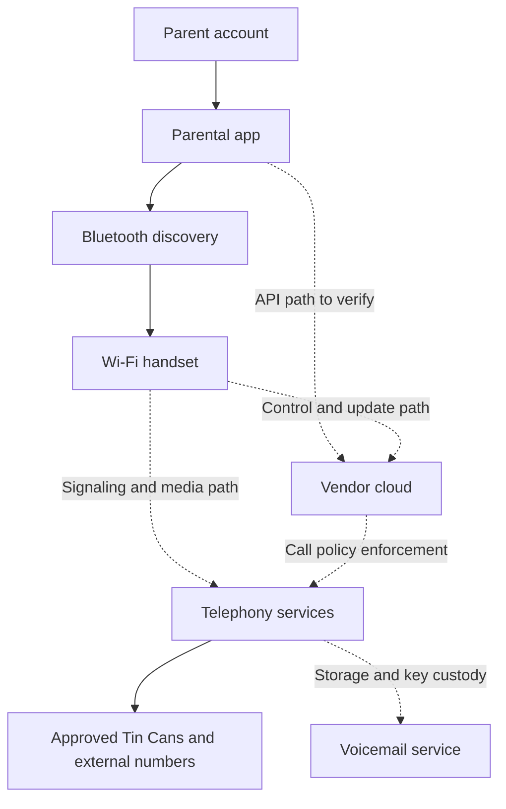

# High-level attack surface

This is a **research model**, not an observed network topology. Solid edges below indicate documented relationships/features, not packet captures. Dashed edges mark routes or implementation details to establish later. References: [baseline](01-recon-baseline.md).

## Assets and boundaries

| Boundary | Assets | Initial questions | First evidence source |
| --- | --- | --- | --- |
| Android OS / app | Tokens, contacts, local configuration | Storage/backup/log exposure? Exported components or unsafe deep links? | Manifest, resources, DEX and native libraries |
| Parent / account service | Account and management permissions | Recovery strength, MFA, session revocation, shared-account limits? | Auth flow and later controlled session observations |
| Household A / household B | Devices, allowlists, logs, audio | Server-side ownership checks on each object and operation? | App call sites; later A/B tests |
| App / nearby handset | Wi-Fi setup, device binding | Bluetooth authentication, physical-presence proof, replay resistance, setup time window? | Plugin/native code, later pairing capture |
| Handset / cloud | Device identity, credentials, policies | Unique identity, certificate validation, scoped privileges, revocation, stale rules? | Firmware + own-device observations |
| Call policy / telephony | Who can reach a child | External caller authenticity, mutual approval, forwarded calls, removal timing? | Call-state map and controlled call scenarios |
| Live voice / provider | Conversation audio and keys | Where does encryption terminate? What distinguishes Tin Can-to-Tin Can from external calls? | Media and key-exchange evidence |
| Voicemail / storage | Recordings, greetings, metadata | Access scope, URL lifetime, deletion, retention, administrative access? | Documented schema + later synthetic-message tests |
| Firmware / update service | Trusted executable code | On-device signature enforcement, trust anchors, anti-rollback, update privileges? | Image/boot metadata and later controlled behavior |
| Physical interfaces / flash | Device secrets, code, microphone | Debug accessibility, encryption, key protection, physical hook-switch gating? | PCB identification, read-only security evidence |
| Vendor support / ownership | Account and device transfer | Identity proof and invalidation of old access? | Documented workflows and later owner-controlled transfer |

Bluetooth is documented; **BLE/GATT is a hypothesis** until the binary or protocol establishes it. SIP is described in hiring material; specific transports, media relays, providers, and ports are unknown. Do not infer Firebase, Cognito, MQTT, WebRTC, or a particular PBX from the cloud or Flutter clues alone.

## Prioritized hypotheses

Priority below is **investigation order**, not vulnerability severity.

| ID | Priority | Hypothesis/question | Evidence that could resolve it | Objective |
| --- | --- | --- | --- | --- |
| H01 | 1 | Device/contact/log operations might lack complete household ownership checks. | Controlled A/B read and mutation comparisons, successful own-object controls, rejected cross-object controls | O2 |
| H02 | 1 | Activation or reset might leave an old manager authorized or allow an unintended claim. | Full claim/reset/transfer state machine, prior tokens tested only against own assets | O3 |
| H03 | 1 | Account recovery/session handling could undermine parental controls. | Auth/session lifecycle and revoked-session results | O2 |
| H04 | 2 | Call filtering might rely on insufficient external caller identity. | Documented authentication and controlled calls from owned numbers | O4 |
| H05 | 2 | Contact removal/quiet hours might leave stale permissive state. | Timestamped app, cloud, handset and call-state observations | O4 |
| H06 | 2 | Voicemail identifiers/links might expose recordings across owners. | Access tests on synthetic recordings created by lab accounts | O5 |
| H07 | 2 | Setup could expose Wi-Fi/device credentials or accept replayed provisioning. | Protocol authentication/encryption and locally controlled replay observations | O3, O6 |
| H08 | 3 | Device flash/debug/update paths might expose credentials or accept untrusted code. | Actual fuse state, identified firmware, observed validation path | O6 |
| H09 | 3 | Firmware could operate the microphone while nominally hung up. | Hook circuit + firmware state + later off-hook/on-hook measurements | O5 |
| H10 | 3 | Identified dependencies might have applicable known vulnerabilities. | Exact component versions, advisory affected ranges, reachable code, device configuration | O6 |

## Scope of conclusions

Static app code can reveal a request path but cannot prove the backend omits authorization. A failed proxy capture cannot prove pinning or audio encryption. A flash read failure cannot prove secure boot. Reading flash is not evidence of credential reusability. Inbound reachability is not evidence of remote microphone activation. Every finding needs the specific missing control and demonstrated consequence.
